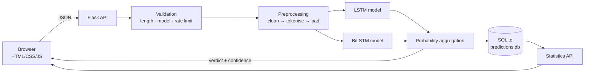
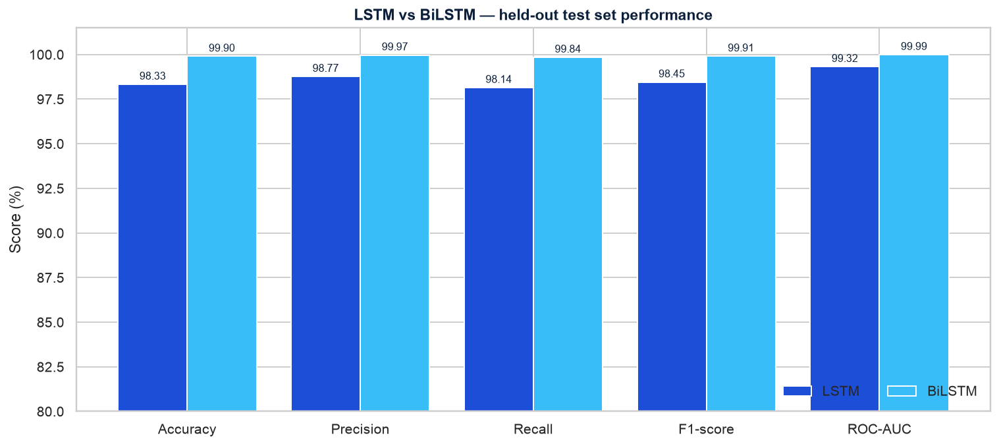
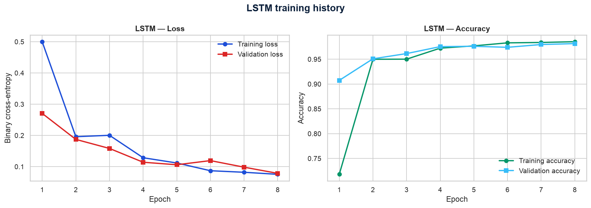
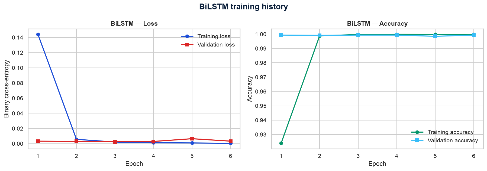
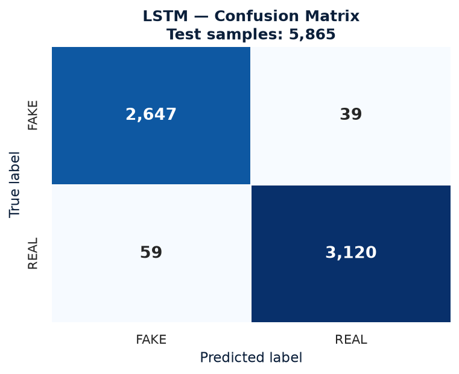
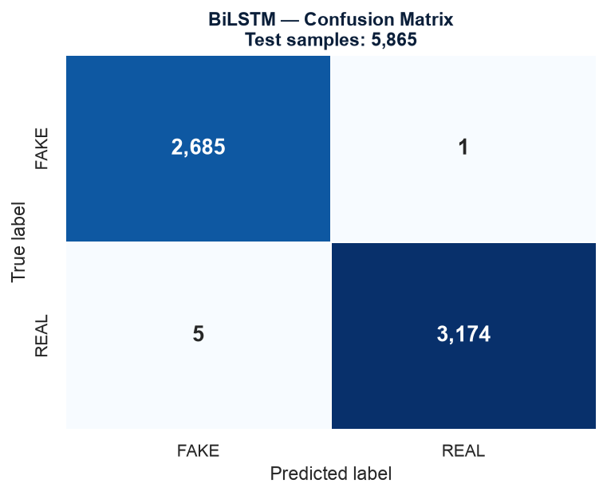
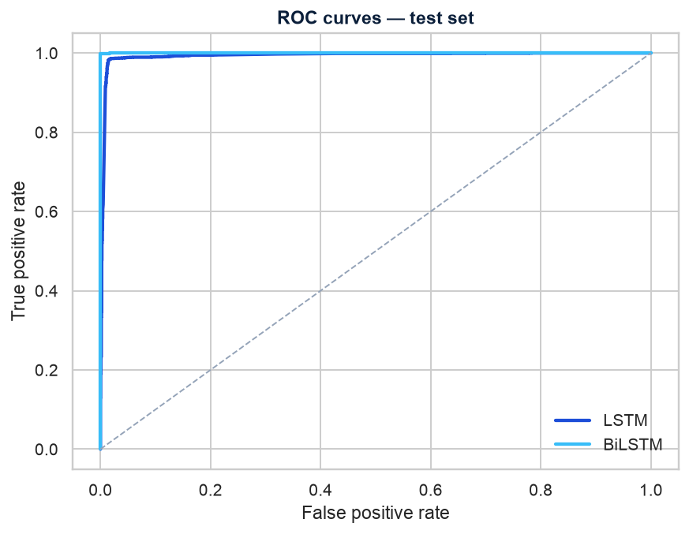

# FAKE NEWS DETECTOR

**An end-to-end deep learning system for news-style classification — TensorFlow · Keras · Flask · SQLite**

A final-year engineering project that trains two recurrent neural networks (LSTM and Bidirectional LSTM) on the
Kaggle *Fake and Real News* dataset, evaluates them rigorously, and serves real-time predictions through a
production-style Flask web application with prediction history and analytics.

> **Responsible-use notice:** this system detects *learned writing patterns*. It is **not** a fact-checker.
> A confidence score is the model's certainty about its own classification — it is **not** the probability
> that an article is factually true. See [Limitations & ethics](#limitations--ethics).

---

## Table of contents

1. [Overview](#overview)
2. [Screenshots](#screenshots)
3. [Problem statement](#problem-statement)
4. [Objectives](#objectives)
5. [Features](#features)
6. [Technology stack](#technology-stack)
7. [Dataset](#dataset)
8. [Project structure](#project-structure)
9. [System architecture](#system-architecture)
10. [Methodology](#methodology)
11. [Results](#results)
12. [Installation](#installation)
13. [Training the models](#training-the-models)
14. [Running the application](#running-the-application)
15. [API documentation](#api-documentation)
16. [Testing](#testing)
17. [Troubleshooting](#troubleshooting)
18. [Limitations & ethics](#limitations--ethics)
19. [Future work](#future-work)
20. [Academic notes](#academic-notes)
21. [References](#references)

---

## Overview

Misinformation travels faster than corrections, and manual fact-checking cannot keep pace with publishing
volume. Fabricated articles, however, often share detectable stylistic traits: sensational claims, unusual
vocabulary, repetitive phrasing and structural differences from wire-service reporting.

This project tests whether sequence models can learn those traits from labelled data — and how honestly the
resulting predictions can be presented.

Two architectures are trained on the same data, with the same preprocessing and hyper-parameters:

| Model | Architecture | Direction |
|---|---|---|
| **LSTM** | Embedding → LSTM(64) → Dropout → Dense(32) → sigmoid | left → right |
| **BiLSTM** | Embedding → Bidirectional(LSTM(64)) → Dropout → Dense(32) → sigmoid | both directions |

Everything is real: the dataset is the original Kaggle corpus, the metrics are computed on a held-out test
split that the models never saw, and the Flask API loads the actual `.keras` checkpoints to answer requests.

---

## Screenshots

Screenshots of the running application (captured from the live server) are stored in
[`static/images/screenshots/`](static/images/screenshots/):

| Page | File |
|---|---|
| Home / landing | `home.png` |
| Detection workspace | `detect.png` |
| Prediction result (full page) | `result.png` |
| Prediction result (panel close-up) | `result-panel.png` |
| Dashboard | `dashboard.png` |
| About / methodology | `about.png` |
| Results section close-up | `results-section.png` |
| Mobile home | `mobile-home.png` |
| Mobile prediction result | `mobile-result.png` |

Training artefacts generated by the scripts:

- `static/images/training_lstm.png` — loss/accuracy curves
- `static/images/training_bilstm.png` — loss/accuracy curves
- `static/images/confusion_matrix_lstm.png`
- `static/images/confusion_matrix_bilstm.png`
- `static/images/model_comparison.png`
- `static/images/roc_curves.png`

---

## Problem statement

> Given the text of a news headline or article, classify it as **FAKE** or **REAL** based on patterns learned
> from a labelled corpus, provide a probability-based confidence score, and communicate the result's limits clearly.

Key engineering challenges addressed:

1. **Data leakage** — the tokenizer must never see validation/test text.
2. **Duplicates** — the raw Kaggle fake-news file contains thousands of exact duplicate rows.
3. **Imbalance & noise** — missing values, HTML fragments, wire-service bylines, boilerplate.
4. **Reproducibility** — fixed seeds, saved tokenizer configuration, saved metrics.
5. **Deployment reality** — model loading, input validation, rate limiting, error handling, persistence and UI.

---

## Objectives

- Build a clean, reproducible text-classification pipeline using Pandas, NLTK, Scikit-learn and Keras.
- Train and compare **LSTM** and **Bidirectional LSTM** classifiers.
- Evaluate with accuracy, precision, recall, F1-score, ROC-AUC and confusion matrices on an untouched test split.
- Persist the tokenizer and preprocessing configuration alongside the model weights.
- Expose predictions through a documented Flask JSON API with validation and error handling.
- Store prediction history in SQLite and visualise statistics on a dashboard.
- Present confidence responsibly, with explicit reliability warnings for short or out-of-vocabulary inputs.
- Deliver a responsive, accessible, product-quality interface (HTML/CSS/JS) rather than a demo page.

---

## Features

**Machine learning**

- Real Kaggle dataset (44,898 raw rows) — no synthetic data, no fabricated metrics.
- Deduplication, missing-value handling, HTML/URL/entity removal, unicode normalisation, stopword filtering
  with negation preservation.
- Stratified 70 / 15 / 15 train–validation–test split performed **before** tokenizer fitting.
- 20,000-token vocabulary, 256-token sequences, 128-dimensional embeddings.
- Early stopping, best-checkpoint restore, learning-rate reduction, gradient clipping.
- Two models, one comparison report, reproducible evaluation script.

**Web application**

- Landing page with live model metrics.
- Detection workspace with sample articles, character counter, model selector and loading state.
- Result panel: verdict, animated confidence gauge, per-model breakdown, explanation, token coverage,
  reliability warning and disclaimer.
- Analytics dashboard: totals, fake/real split, average confidence, latency, 7-day trend, confidence
  distribution, architecture comparison and filterable history.
- About page: objectives, methodology, architecture, results, limitations.
- Fully responsive (desktop → mobile), keyboard accessible, reduced-motion aware, self-hosted fonts.

**Backend**

- `POST /predict` with JSON/form input, strict validation, rate limiting and SQLite persistence.
- `GET /dashboard` (HTML or JSON), `GET /history`, `DELETE /history`, `/api/models`, `/api/health`.
- Thread-safe model loading, single TensorFlow import, warm-up on startup.
- Graceful 400/404/405/413/429/500/503 responses.

---

## Technology stack

| Layer | Technology |
|---|---|
| Language | Python 3.13 (3.10–3.13 supported) |
| Deep learning | TensorFlow 2.21 / Keras 3 |
| NLP | NLTK (stopwords, tokenizer data), Keras `Tokenizer` |
| Classical ML utilities | Scikit-learn (split, metrics), Pandas, NumPy |
| Visualisation | Matplotlib, Seaborn, Chart.js (vendored) |
| Backend | Flask 3, Jinja2 |
| Database | SQLite 3 |
| Frontend | HTML5, CSS3 (custom design system), vanilla JavaScript |
| Model storage | Keras `.keras` format, Pickle (tokenizer), JSON (metrics/config) |

---

## Dataset

### Source

**Kaggle — Fake and Real News Dataset** by *Clément Bisaillon*
<https://www.kaggle.com/datasets/clmentbisaillon/fake-and-real-news-dataset>

Files required in `dataset/`:

```
dataset/
├── Fake.csv    # fabricated articles, label 0
└── True.csv    # Reuters-style reporting, label 1
```

### How to download

**Option A — kagglehub (recommended, used in this project)**

```bash
pip install kagglehub
python - <<'PY'
import kagglehub, shutil, os
src = kagglehub.dataset_download("clmentbisaillon/fake-and-real-news-dataset")
os.makedirs("dataset", exist_ok=True)
for name in ("Fake.csv", "True.csv"):
    shutil.copy(os.path.join(src, name), os.path.join("dataset", name))
print("Dataset ready in ./dataset")
PY
```

**Option B — Kaggle website**

1. Sign in at <https://www.kaggle.com/datasets/clmentbisaillon/fake-and-real-news-dataset>.
2. Click **Download** (≈ 116 MB zip).
3. Extract `Fake.csv` and `True.csv` into the `dataset/` folder.

**Option C — Kaggle CLI**

```bash
pip install kaggle
# Place your API token at ~/.kaggle/kaggle.json first
kaggle datasets download -d clmentbisaillon/fake-and-real-news-dataset -p dataset --unzip
```

If the files are missing, `preprocess.py` raises a clear error with these instructions — the project never
substitutes synthetic data.

### Dataset profile (measured by this project)

| Metric | Value |
|---|---|
| Raw rows | 44,898 |
| Fake.csv / True.csv | 23,481 / 21,417 |
| Exact duplicate `title+text` rows removed | 5,793 (5,573 of them in Fake.csv) |
| Usable articles after cleaning | 39,097 |
| Fake / Real after cleaning | 17,901 / 21,196 |
| Train / Validation / Test | 27,367 / 5,865 / 5,865 |
| Vocabulary (training split only) | 20,000 tokens |

Columns: `title`, `text`, `subject`, `date`. The loader concatenates `title` and `text` and creates the
binary label. The raw `subject` and `date` columns are **not** used as features — that would encode
publisher/date shortcuts rather than language.

---

## Project structure

```
fake-news-detection/
│
├── dataset/
│   ├── Fake.csv                  # raw Kaggle data (downloaded)
│   ├── True.csv
│   └── cleaned_corpus.pkl        # cache generated by preprocess.py (git-ignored)
│
├── models/
│   ├── lstm_model.keras          # trained LSTM checkpoint
│   ├── bilstm_model.keras        # trained BiLSTM checkpoint
│   ├── tokenizer.pkl             # fitted Keras tokenizer
│   ├── preprocessor_config.json  # max_len, vocab size, cleaning metadata
│   ├── metrics.json              # test metrics + training history + config
│   └── history/                  # per-epoch CSV logs
│
├── notebooks/
│   └── model_training.ipynb      # documented EDA + training walkthrough
│
├── static/
│   ├── css/style.css             # design system (responsive)
│   ├── js/main.js                # navigation, toasts, reveal, API helper
│   ├── js/detect.js              # detection workspace logic
│   ├── js/dashboard.js           # dashboard charts + history
│   ├── js/vendor/chart.umd.min.js
│   ├── fonts/                    # self-hosted Plus Jakarta Sans (woff2)
│   └── images/                   # charts + screenshots
│
├── templates/
│   ├── base.html                 # shared layout, nav, footer
│   ├── index.html                # landing page
│   ├── detect.html               # detection workspace
│   ├── dashboard.html            # analytics dashboard
│   ├── about.html                # project documentation
│   └── error.html                # 404/405/500 page
│
├── database/
│   └── predictions.db            # SQLite (created automatically)
│
├── tests/
│   └── test_system.py            # unit + API + database tests
│
├── reports/
│   ├── model_comparison.csv      # generated comparison table
│   ├── evaluation_report.json    # independent evaluation output
│   └── training_log.txt
│
├── app.py                        # Flask app factory + API
├── train_model.py                # trains LSTM and BiLSTM
├── evaluate_model.py             # re-evaluates saved models
├── preprocess.py                 # cleaning, dataset loading, tokenizer
├── predict.py                    # inference engine + CLI
├── evaluation.py                 # shared metrics + plots
├── database.py                   # SQLite helpers
├── download_dataset.py           # optional kagglehub downloader
├── config.py                     # central configuration
├── requirements.txt
└── README.md
```

---

## System architecture



**Request flow**

1. The user submits text from `/detect`.
2. `POST /predict` validates the payload (`15–20,000` characters, known model, rate limit).
3. `preprocess.clean_text` normalises the article; the persisted tokenizer converts it to a padded
   256-integer sequence.
4. Both models run (a few milliseconds each); the selected model — or the ensemble mean — produces `P(real)`.
5. The verdict, confidence, per-model scores, reliability note and explanation are returned and stored
   in SQLite.
6. The dashboard reads aggregates from SQLite; model accuracy figures are read from `models/metrics.json`
   (generated during training), never hardcoded.

---

## Methodology

### 1. Data assembly

```python
fake = pd.read_csv("dataset/Fake.csv"); fake["label"] = 0
real = pd.read_csv("dataset/True.csv"); real["label"] = 1
df = pd.concat([fake, real]).sample(frac=1, random_state=42)
```

- Drop rows with missing `title`/`text`.
- Drop exact duplicates on `title+text`.
- Drop articles shorter than 25 characters.
- Merge `title + ". " + text` into one content field.

### 2. Cleaning (stateless → safe before splitting)

| Step | Implementation |
|---|---|
| HTML | `<[^>]+>` removal + `html.unescape` |
| URLs / emails | regex removal |
| Wire byline | strips leading `CITY (Reuters) -` |
| Unicode | NFKD normalisation, combining marks removed |
| Case / punctuation / digits | lowercased, translated to spaces, digits removed |
| Tokenisation | `[a-z]+` regex |
| Stopwords | NLTK English stopwords **minus** negations (`not`, `never`, `no`, …) and question words |

Example:

```
"<p>BREAKING: Trump said NO to the 'FAKE' news in 2019! Visit https://x.com</p>"
→ "breaking trump said no fake news visit"
```

### 3. Leakage-free split

```python
train_df, temp = train_test_split(df, test_size=0.30, stratify=df.label, random_state=42)
val_df, test_df = train_test_split(temp, test_size=0.50, stratify=temp.label, random_state=42)
preprocessor = TextPreprocessor().fit(train_df["clean"])   # training split only
```

Sequence statistics: 70% train, 15% validation, 15% test, stratified by class.
Articles longer than 256 tokens are truncated (post-truncation, roughly a quarter of the corpus).

### 4. Model architectures

**LSTM**

```
Input (256)
→ Embedding(20,000 × 128)
→ SpatialDropout1D(0.20)
→ LSTM(64, dropout=0.20)
→ Dropout(0.40)
→ Dense(32, ReLU)
→ Dropout(0.20)
→ Dense(1, sigmoid)
```

**BiLSTM** — identical, except:

```
→ Bidirectional(LSTM(64, dropout=0.20))
```

**Training configuration**

| Setting | Value |
|---|---|
| Optimizer | Adam, learning rate 5e-4, gradient clip-norm 1.0 |
| Loss | Binary cross-entropy (labels: 0 = FAKE, 1 = REAL) |
| Batch size | 128 |
| Max epochs | 8 |
| Early stopping | `val_loss`, patience 3, restore best weights |
| LR schedule | `ReduceLROnPlateau`, factor 0.5, patience 2, min 1e-5 |
| Decision threshold | 0.5 |
| Seed | 42 (Python, NumPy, TensorFlow) |

### 5. Evaluation

Every model is scored once on the held-out test split after reloading its best checkpoint:

- Accuracy, precision, recall, F1-score, ROC-AUC
- Confusion matrix (TP/TN/FP/FN)
- Per-class classification report
- Training/validation curves
- Inference latency per article

Artifacts are written to `models/metrics.json`, `reports/` and `static/images/`.

---

## Results

All figures below were computed on the **held-out test split (5,865 articles)** that was never used for
training or validation. They are read from `models/metrics.json` and independently reproduced by
`evaluate_model.py`.

### Model comparison

| Model | Accuracy | Precision | Recall | F1-score | ROC-AUC | Parameters | Epochs | Train time |
|---|---|---|---|---|---|---|---|---|
| **LSTM** | 98.33% | 98.77% | 98.14% | 98.45% | 0.9932 | 2,611,521 | 8 | 285.9 s |
| **BiLSTM** | **99.90%** | **99.97%** | **99.84%** | **99.91%** | **0.9999** | 2,662,977 | 6 | 439.2 s |

### Confusion matrices (test set)

| Model | TN | FP | FN | TP | Total errors |
|---|---|---|---|---|---|
| LSTM | 2,647 | 39 | 59 | 3,120 | 98 / 5,865 |
| BiLSTM | 2,685 | 1 | 5 | 3,174 | **6 / 5,865** |

Labels: negative class = FAKE (2,686 test articles), positive class = REAL (3,179 test articles).

### Visualisations



| LSTM training history | BiLSTM training history |
|---|---|
|  |  |

| LSTM confusion matrix | BiLSTM confusion matrix |
|---|---|
|  |  |



### Interpretation

- **The BiLSTM is the better classifier on every headline metric.** It reduced test-set errors from 98 to 6
  (−94%) while adding only ~51k parameters (2.61 M → 2.66 M). Reading each token with both left and right
  context helps with negation scope and clauses that resolve later in a sentence.
- **The LSTM is not a weak baseline.** 98.33% accuracy and 0.9845 F1 make it a credible, faster model
  (285.9 s vs 439.2 s training). Both models beat the majority-class baseline (54.2% real) by a wide margin.
- **Precision is higher than recall for both models** — the models are slightly more conservative about
  labelling an article REAL than about catching FAKE. On this task, that trade-off means fewer real articles
  are mislabelled fake (39/3,179 for LSTM, 1/3,179 for BiLSTM) at the cost of missing some fake articles
  (59 and 5 respectively).
- **The gap is smaller than it looks in production terms.** With only 6 errors, the BiLSTM's residual mistakes
  are near the noise floor of the labels; differences of a few articles are not statistically meaningful.
- **These numbers do not mean "fake news is solved".** The corpus pairs a narrow set of alternative outlets
  with mostly Reuters copy, so publisher-specific stylistic cues are learnable. Cross-domain performance
  would be lower. See [Limitations](#limitations--ethics).

**Reproduce these numbers**

```bash
python evaluate_model.py     # reloads the shipped .keras files and recomputes every metric
cat reports/model_comparison.csv
```

---

## Installation

### Requirements

- Python **3.10 – 3.13** (TensorFlow does not publish wheels for 3.14 at the time of writing)
- ~2 GB free disk space (dataset + TensorFlow + models)
- macOS, Linux or Windows

### Steps

```bash
# 1. Enter the project
cd fake-news-detection

# 2. Create and activate a virtual environment
python3.13 -m venv .venv
source .venv/bin/activate          # Windows: .venv\Scripts\activate

# 3. Install dependencies
pip install --upgrade pip
pip install -r requirements.txt

# 4. Download the dataset into dataset/ (or copy it manually)
python download_dataset.py

# 5. (Optional) download NLTK resources explicitly.
#    preprocess.py does this automatically into ./nltk_data
python -c "import nltk; nltk.download('stopwords'); nltk.download('punkt'); nltk.download('punkt_tab')"
```

> **macOS SSL error while downloading NLTK data?**
> Run `/Applications/Python\ 3.13/Install\ Certificates.command`, or prefix the command with
> `SSL_CERT_FILE=$(python -c "import certifi; print(certifi.where())")`.
> This project already ships the downloaded resources under `nltk_data/`.

---

## Training the models

```bash
# Optional: build the cleaned corpus cache and inspect dataset statistics
python preprocess.py

# Train both models (writes models/*.keras, tokenizer.pkl, metrics.json, charts)
python train_model.py --epochs 8

# Independent verification on the test split
python evaluate_model.py

# Quick runs / single architecture
python train_model.py --epochs 3
python train_model.py --model bilstm
```

Expected runtime on an Apple Silicon laptop (CPU): **≈ 1–2 minutes per epoch per model**, ~10 minutes for a
full two-model run. Training uses early stopping, so it usually finishes before the epoch limit.

Generated files:

| File | Contents |
|---|---|
| `models/lstm_model.keras` | best LSTM checkpoint |
| `models/bilstm_model.keras` | best BiLSTM checkpoint |
| `models/tokenizer.pkl` | Keras tokenizer fitted on train split |
| `models/preprocessor_config.json` | max length, vocabulary, cleaning metadata |
| `models/metrics.json` | test metrics, history, hyper-parameters, comparison |
| `models/history/*.csv` | epoch-level loss/accuracy logs |
| `static/images/*.png` | training curves, confusion matrices, comparison, ROC |
| `reports/model_comparison.csv` | comparison table |
| `reports/evaluation_report.json` | independent evaluation report |

> Model files are ~30 MB each and are not suitable for email. Retrain to regenerate, or share via cloud storage.

---

## Running the application

```bash
source .venv/bin/activate
python app.py
```

Open **<http://127.0.0.1:5000>**.

The models are loaded once in a background warm-up thread. First prediction after startup may take ~1 second;
subsequent predictions are a few milliseconds.

Production-style run (optional):

```bash
pip install gunicorn
gunicorn -w 1 -b 0.0.0.0:8000 "app:create_app()"
```

> Use **one worker** (or preload the models per worker): each worker maintains its own model copy.
> For multiple workers, ensure enough RAM (~1 GB per worker).

Environment variables:

| Variable | Default | Purpose |
|---|---|---|
| `PORT` | `5000` | HTTP port for `python app.py` |
| `FLASK_DEBUG` | `0` | `1` enables debug logging |
| `FND_DATABASE` | `database/predictions.db` | SQLite path |
| `FND_RATE_LIMIT` | `120` | Requests per minute per IP (`0` disables) |
| `FND_WARMUP` | `1` | `1` loads models at startup, `background` loads them asynchronously (WSGI), `0` disables warm-up |

---

## API documentation

Base URL: `http://127.0.0.1:5000`

### `POST /predict`

Classify a headline or article.

**Request**

```json
{
  "text": "WASHINGTON (Reuters) - The Senate approved the bill on Tuesday...",
  "model": "bilstm"
}
```

`model` is one of `lstm`, `bilstm`, `ensemble` (default: `bilstm`). Form-encoded bodies are also accepted.

**Response `200`**

```json
{
  "success": true,
  "id": 42,
  "prediction": "REAL",
  "label_code": 1,
  "confidence": 0.9987,
  "confidence_percent": 99.87,
  "model_key": "bilstm",
  "model_used": "BiLSTM",
  "probability_real": 0.9987,
  "probability_fake": 0.0013,
  "model_scores": [
    {"key": "lstm", "label": "LSTM", "prediction": "REAL",
     "probability_real": 0.9961, "probability_fake": 0.0039, "confidence": 0.9961},
    {"key": "bilstm", "label": "BiLSTM", "prediction": "REAL",
     "probability_real": 0.9987, "probability_fake": 0.0013, "confidence": 0.9987}
  ],
  "explanation": "The BiLSTM classified this text as REAL NEWS with 99.9% confidence ...",
  "disclaimer": "This prediction is produced by a deep-learning model ...",
  "text_stats": {
    "characters": 512,
    "words_raw": 90,
    "tokens_used": 74,
    "vocabulary_coverage": 0.93,
    "truncated": false,
    "max_len": 256
  },
  "reliability": {"level": "high", "message": "Input length and vocabulary coverage are sufficient ..."},
  "processing_ms": 18.4,
  "threshold": 0.5,
  "stored": true,
  "timestamp": "2026-11-15 18:40:12"
}
```

**Errors**

| Status | Cause |
|---|---|
| `400` | missing/empty/non-string text, too short, unknown model, invalid JSON |
| `413` | text > 20,000 characters, or body > 2 MB |
| `422` | input contains no usable English tokens |
| `429` | rate limit exceeded |
| `503` | trained models are not available (run `train_model.py`) |

Error body: `{"success": false, "error": "…", "status": 400}`.

### `GET /dashboard`

Returns HTML for browsers. With `Accept: application/json` or `?format=json`, returns statistics:

```json
{
  "success": true,
  "total_predictions": 12,
  "fake_predictions": 5,
  "real_predictions": 7,
  "fake_percentage": 41.7,
  "real_percentage": 58.3,
  "average_confidence": 0.9412,
  "average_latency_ms": 21.3,
  "predictions_today": 4,
  "by_model": [{"model": "BiLSTM", "count": 12}],
  "trend": [{"day": "2026-11-09", "label": "Sun", "fake": 0, "real": 1, "total": 1}],
  "confidence_distribution": [{"bucket": "90-100%", "count": 9}],
  "model_performance": {"lstm": {"accuracy": 0.99}, "bilstm": {"accuracy": 0.99}},
  "best_model": "bilstm"
}
```

### `GET /history`

`?limit=20&label=FAKE|REAL` (limit 1–500).

```json
{"success": true, "count": 1, "predictions": [
  {"id": 42, "created_at": "2026-11-15 18:40:12", "text_preview": "…",
   "label": "REAL", "confidence": 0.9987, "model": "BiLSTM", "word_count": 90}
]}
```

Also available as `GET /api/history`.

### `DELETE /history`

Deletes all stored predictions. Returns `{"success": true, "deleted": 12}`.

### `GET /api/models`

Model metadata and verified test metrics (read from `models/metrics.json`).

### `GET /api/health`

Service health, loaded models, database status, TensorFlow version.
Returns `200` when models and database are ready, `503` otherwise.

### `GET /api/predictions/<id>`

Returns one stored prediction including the full text field.

### Example requests

```bash
curl -s http://127.0.0.1:5000/predict \
  -H "Content-Type: application/json" \
  -d '{"text":"The central bank raised interest rates by 25 basis points on Thursday, citing persistent inflation.","model":"bilstm"}' | python -m json.tool

curl -s http://127.0.0.1:5000/api/dashboard | python -m json.tool
curl -s "http://127.0.0.1:5000/api/history?limit=5&label=FAKE" | python -m json.tool
curl -s http://127.0.0.1:5000/api/health | python -m json.tool
```

### Command-line prediction

```bash
python predict.py --model bilstm "Breaking: scientists confirm the moon is made of cheese"
echo "Article text ..." | python predict.py --model ensemble
```

---

## Testing

```bash
source .venv/bin/activate
python -m unittest discover -s tests -v
```

Coverage includes:

- **Preprocessing** — HTML/URL removal, stopword filtering, negation preservation, NaN handling,
  digits/punctuation, tokenizer determinism and padded shape.
- **Predictor** — model loading, output ranges, all three model options, special characters, long input
  truncation, unknown/empty input rejection, real metric presence.
- **API** — all pages render, JSON vs HTML 404, valid prediction, persistence, form bodies, ensemble,
  empty/short/missing/non-string/oversized input, invalid model, invalid JSON, statistics correctness,
  dashboard negotiation, history limit/filter validation, clearing history, health and model endpoints.
- **Database** — schema creation, aggregation, preview truncation, empty-DB statistics.

Tests use a temporary SQLite database (`FND_DATABASE`), so your real history is untouched.
Tests that need model weights are skipped automatically if the models have not been trained yet.

Manual checklist (all verified before delivery):

- [x] Fake-style input returns a prediction
- [x] Real-style input returns a prediction
- [x] Empty input rejected with a helpful message
- [x] Very short input rejected
- [x] Long article accepted and truncated
- [x] Special-character-only input rejected
- [x] Prediction stored in SQLite and visible in history
- [x] Dashboard totals match stored rows
- [x] Model artifacts load after a cold start
- [x] 404 page and JSON errors behave correctly

---

## Troubleshooting

| Problem | Fix |
|---|---|
| `ModuleNotFoundError: tensorflow` | Activate the venv: `source .venv/bin/activate`; install `-r requirements.txt`. |
| `No matching distribution found for tensorflow` | You are on Python 3.14+. Use Python 3.10–3.13 for the venv. |
| `Dataset file not found` | Place `Fake.csv`/`True.csv` in `dataset/` (see [Dataset](#dataset)). |
| `No trained model could be loaded` | Run `python train_model.py` before starting the app. |
| NLTK `SSL: CERTIFICATE_VERIFY_FAILED` | Run the Python certificate installer, or set `SSL_CERT_FILE` to `certifi.where()`. |
| Charts missing on the About page | Run `python train_model.py` or `python evaluate_model.py` to regenerate PNGs. |
| Port 5000 already in use | `PORT=5001 python app.py` (macOS AirPlay uses 5000). |
| Predictions slow on first request | Model warm-up is still running; check `/api/health` until `models_loaded` is true. |
| `database is locked` | Close other processes using SQLite; the app uses WAL mode and short-lived connections. |
| Low memory with gunicorn | Use one worker, or preload models and limit workers. |

---

## Limitations & ethics

This project deliberately documents its weaknesses:

1. **Not a fact-checker.** The output is a stylistic classification. It cannot verify sources, quotes or events.
   Confidence means model certainty, not truth. Because a saturated sigmoid can round to 100%, the API's
   `confidence_percent`, the explanation text and every UI percentage are capped at **99.9%** so the interface
   never implies absolute certainty.
2. **Publisher/topic bias.** Fake articles come largely from a set of alternative outlets; real articles largely
   from Reuters. Publisher-specific cues make the task easier than real-world misinformation detection.
3. **Temporal drift.** The corpus covers 2015–2018. Vocabulary and conventions change; re-validate before
   applying to current content.
4. **English-only, length-limited.** Inputs are truncated at 256 tokens; satire, translations and very short
   headlines are outside the model's competence (the UI warns about this).
5. **Short inputs are the weakest case.** The networks were trained on full articles. In testing, a neutral
   19-token sentence was labelled FAKE with ~99% confidence, while the same writing style extended to 129
   tokens was labelled REAL with ~99.5% confidence. The API and UI add an explicit caution when fewer than
   80 analysable tokens remain, but confidence is not statistically calibrated for such inputs — prefer full
   articles whenever possible.
6. **Near-duplicates.** Exact duplicates are removed, but paraphrased duplicates may remain, slightly inflating
   test scores.
7. **No evidence extraction.** The interface shows per-model agreement and token coverage, not highlighted
   evidence spans. Attention visualisation is future work.
8. **Misuse risk.** Automated verdicts can be weaponised. The UI frames results as signals, warns on weak inputs,
   and stores no personal data. Do not use this to label individuals or publishers.

**Ethical use:** academic demonstration, teaching, and research prototyping only. Always consult primary
sources and professional fact-checkers for real-world decisions.

---

## Future work

- Transformer baseline (DistilBERT / RoBERTa) and comparison against recurrent models.
- Cross-dataset evaluation (LIAR, ISOT extensions) to measure generalisation beyond publisher cues.
- Attention/saliency visualisation to highlight influential tokens.
- Probability calibration (temperature scaling) and threshold tuning per use case.
- Active learning loop with human feedback stored alongside predictions.
- Docker image, Postgres backend, authentication and per-user history.
- Multilingual models and explainable evidence retrieval.

---

## Academic notes

**Suitable for:** final-year B.E./B.Tech major project, MCA/M.Sc. dissertation, deep learning coursework.

**Viva / report talking points**

- Why split before fitting the tokenizer? To prevent vocabulary leakage from test data.
- Why deduplicate? The Fake.csv file contains 5,573 exact duplicates; keeping them double-counts examples.
- Why two models? To isolate the effect of bidirectionality while holding preprocessing and hyper-parameters constant.
- Why accuracy alone is insufficient? Precision/recall/F1 and the confusion matrix expose class-specific errors;
  ROC-AUC shows separability independent of threshold.
- Why is 99% accuracy not "solved fake news"? Publisher and stylistic shortcuts in the dataset; see limitations.
- How is confidence computed? Sigmoid output = P(real); confidence is the probability of the predicted class.
  Displayed percentages are capped at 99.9% because a saturated output is not proof.
- How is history stored? SQLite table `predictions`, one row per request, including text preview and model scores.

**Project metadata**

| Field | Value |
|---|---|
| Title | Fake News Detection System using Deep Learning |
| Models | LSTM, Bidirectional LSTM |
| Dataset | Kaggle Fake and Real News Dataset (44,898 raw rows) |
| Framework | TensorFlow / Keras, Flask |
| Artifacts | `.keras` checkpoints, Pickle tokenizer, JSON metrics, SQLite DB |

---

## References

1. Bisaillon, C. *Fake and Real News Dataset*. Kaggle, 2020.
   <https://www.kaggle.com/datasets/clmentbisaillon/fake-and-real-news-dataset>
2. Hochreiter, S. & Schmidhuber, J. (1997). *Long Short-Term Memory*. Neural Computation, 9(8), 1735–1780.
3. Schuster, M. & Paliwal, K. K. (1997). *Bidirectional Recurrent Neural Networks*. IEEE Transactions on Signal Processing.
4. Chollet, F. *Deep Learning with Python* (2nd ed.). Manning, 2021.
5. TensorFlow / Keras documentation — <https://www.tensorflow.org/guide/keras>
6. NLTK documentation — <https://www.nltk.org/>
7. Flask documentation — <https://flask.palletsprojects.com/>

---

## License & credits

Released for academic and educational use. The dataset is distributed under its own Kaggle terms; consult the
dataset page before redistribution. Model weights and source code in this repository were produced for this
project and may be reused with attribution.

**Built with TensorFlow, Keras, NLTK and Flask.**
